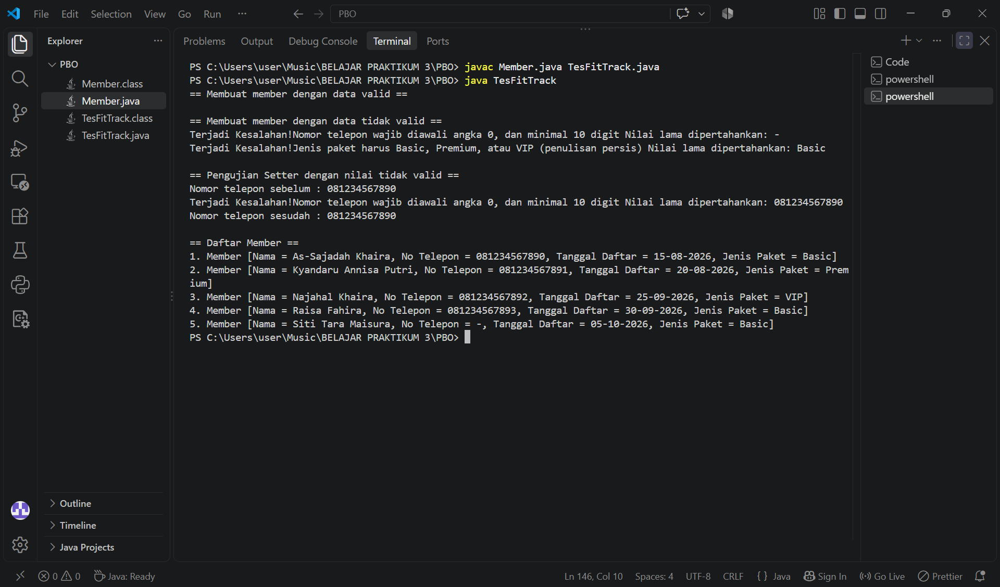

# Tugas 1 - Sistem Keanggotaan Gym FitTrack
- **Nama:** AS-SAJADAH KHAIRA
- **NPM:** 250810701100005
- **Kelas Praktikum:** Praktikum PBO A

## Deskripsi Singkat
FitTrack adalah gym kecil dengan sekitar 150 member aktif yang masih mencatat data di buku tulis, sehingga data mudah tercecer dan salah ketik.
Program Java ini membantu pendataan member sebagai langkah awal digitalisasi, dengan fokus memastikan data yang masuk selalu valid.
Dengan begitu, kesalahan seperti nomor telepon yang salah format tidak lagi menyulitkan staf menghubungi member.

## Fitur Utama
1. Menyimpan data member: nama, nomor telepon, tanggal daftar, dan jenis paket.
2. Menolak nama yang kosong atau hanya berisi spasi.
3. Menolak nomor telepon yang tidak diawali 0, berisi selain angka, atau kurang dari 10 digit.
4. Menolak jenis paket selain Basic, Premium, dan VIP.
5. Menampilkan alasan penolakan yang jelas beserta nilai lama yang dipertahankan.
6. Membuat member tanpa memilih paket (otomatis Basic).
7. Tetap membuat data member dengan nilai default yang aman saat ada data yang tidak valid.
8. Menampilkan seluruh daftar member dengan format rapi dan berlabel.

## Konsep OOP yang Diterapkan
| Konsep | Lokasi | Alasan |
|---|---|---|
| Encapsulation | Atribut `private` di class `Member` | Data hanya bisa diubah lewat setter sehingga selalu melewati validasi |
| Constructor | `Member(nama, noTelepon, tanggalDaftar, jenisPaket)` | Mengisi atribut lewat setter agar validasi tidak ditulis ulang di constructor |
| Constructor overloading dan `this(...)` | `Member(nama, noTelepon, tanggalDaftar)` | Memberi cara membuat member tanpa paket dengan memakai ulang constructor lengkap |
| Getter dan setter | Seluruh atribut di class `Member` | Setter menjadi satu-satunya tempat validasi (prinsip DRY) |
| Override | `toString()` di class `Member` | Objek tercetak rapi dan berlabel, bukan alamat memori bawaan Java |
| Konstanta `final` | `MINIMAL_PANJANG_TELEPON`, `AWALAN_NOMOR_TELEPON`, `PAKET_BASIC`, dan lainnya | Menghindari magic number dan magic string, serta mudah diubah dari satu tempat |
| Array | `Member[]` di class `TesFitTrack` | Menyimpan banyak objek `Member` dalam satu struktur |

## Struktur Project
```
tugas1-fittrack/
├── src/
│   ├── Member.java
│   └── TesFitTrack.java
├── .gitignore
├── Output.png
└── README.md
```

## Prasyarat
- JDK 21 (diuji dengan versi 21.0.12.1)
- IDE yang disarankan: IntelliJ IDEA Community Edition

## Cara Menjalankan Program
**Lewat IntelliJ IDEA:**
1. Buka project di IntelliJ IDEA, lalu buka file `src/TesFitTrack.java`.
2. Klik ikon segitiga hijau di samping `public static void main`.
3. Pilih **Run 'TesFitTrack.main()'**. Hasilnya tampil di panel Run bagian bawah.

**Lewat command line:**
```
cd src
javac Member.java TesFitTrack.java
java TesFitTrack
```

## Contoh Output

Bagian `Daftar member` menunjukkan skenario normal. Baris `Terjadi Kesalahan!` menunjukkan validasi menolak data yang tidak valid, sementara nilai lama tetap dipertahankan.

## Nilai Default
Nilai default dipakai saat nilai awal dari constructor ditolak oleh setter, sehingga objek tetap terbentuk dan program tidak berhenti.

| Atribut | Default | Alasan |
|---|---|---|
| nama | `Tanpa Nama` | Tidak mengarang nama palsu, dan staf langsung tahu data belum lengkap |
| noTelepon | `-` | Sengaja bukan angka agar tidak terlihat seperti nomor asli yang bisa dihubungi |
| tanggalDaftar | `-` | Tidak mengarang tanggal yang bisa menyesatkan perhitungan masa keanggotaan |
| jenisPaket | `Basic` | Paket paling dasar, sehingga member tidak mendapat fasilitas lebih dari yang dibayar |

## Batasan dan Pengembangan Lanjutan
- Data hanya tersimpan selama program berjalan dan belum tersambung ke database.
- Tanggal daftar baru diperiksa tidak kosong, belum dicek apakah tanggalnya benar-benar ada di kalender.
- Belum ada fitur mencari, mengubah, atau menghapus member lewat menu interaktif.
- Pesan penolakan masih ditulis langsung ke layar, belum dipisah dari logika validasi.
